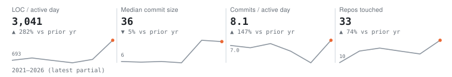

- 👋 Hi, I'm @apandeya
- 🛠️ Backend & data engineer
- 🌱 Currently exploring AI-assisted / agentic coding workflows — see the chart below 👇

<!-- CHART:START -->
<picture>
  <source media="(prefers-color-scheme: dark)" srcset="stats/coding-velocity-dark.svg">
  <source media="(prefers-color-scheme: light)" srcset="stats/coding-velocity-light.svg">
  
</picture>

🔥 Active on 20 of the last 30 days &nbsp;·&nbsp; _last updated 2026-08-31_
<!-- CHART:END -->

Full year-by-year breakdown ▾

<!-- STATS:START -->
| Year | Commits | LOC changed | Active days | LOC/day | Median LOC/commit | Mean LOC/commit | Repos touched |
|---|---|---|---|---|---|---|---|
| 2021 | 436 | 42,976 | 62 | 693 | 6 | 98.6 | 10 |
| 2022 | 1,182 | 173,764 | 181 | 960 | 5 | 147 | 22 |
| 2023 | 1,373 | 125,828 | 185 | 680 | 6 | 91.6 | 25 |
| 2024 | 781 | 53,914 | 135 | 399 | 4 | 69 | 22 |
| 2025 | 385 | 93,070 | 117 | 795 | 38 | 241.7 | 19 |
| 2026 \* | 922 | 336,373 | 111 | 3,030 | 36.5 | 364.8 | 33 |

\* partial year
<!-- STATS:END -->

<!---
apandeya/apandeya is a ✨ special ✨ repository because its `README.md` (this file) appears on your GitHub profile.
You can click the Preview link to take a look at your changes.
--->
